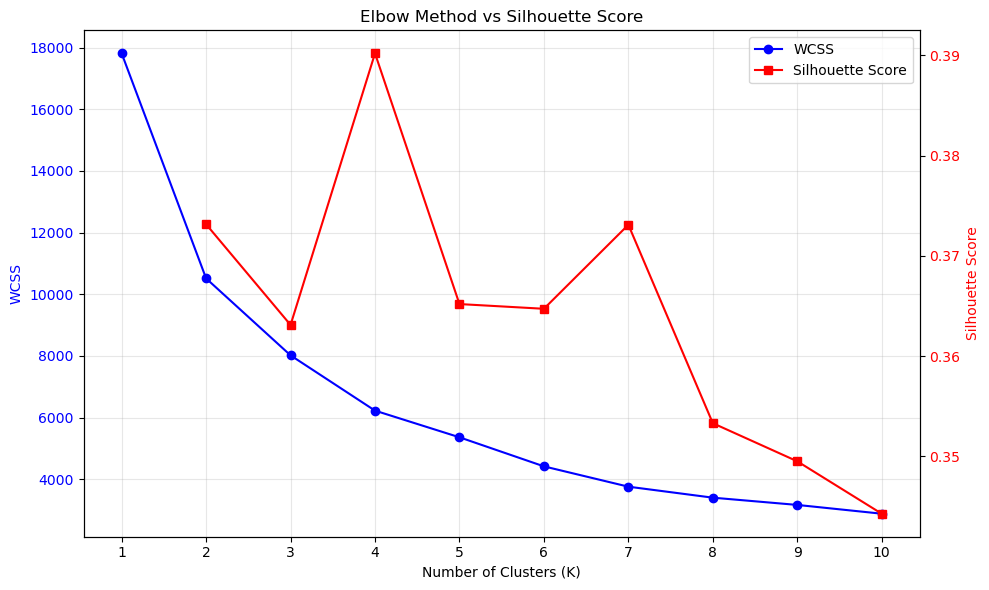
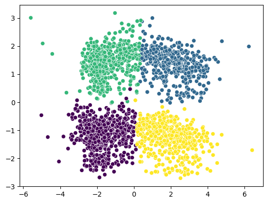
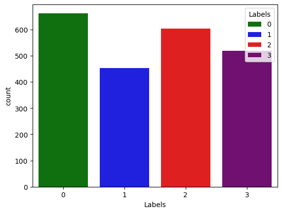
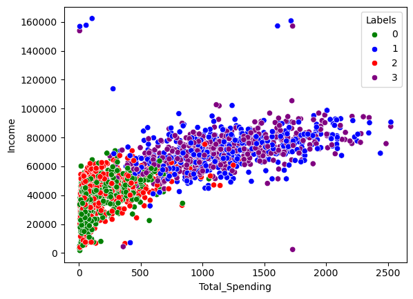

# SmartSeg: Customer Segmentation

SmartSeg explores customer purchasing behavior and groups customers with unsupervised learning. The notebooks clean a customer dataset, examine its features, reduce it to three principal components, and compare KMeans with agglomerative clustering. The selected model uses **four KMeans clusters**.

## Interactive dashboard

The Streamlit app in [`src/app.py`](src/app.py) provides an overview, interactive segment comparisons, a customer table and CSV download, and a form that assigns a customer to a segment. Data loading and profiles live in [`src/data.py`](src/data.py), Plotly styling in [`src/charts.py`](src/charts.py), and reusable HTML in [`src/ui.py`](src/ui.py) and [`src/templates`](src/templates). Native controls use the Streamlit theme in [`.streamlit/config.toml`](.streamlit/config.toml).

```bash
python -m pip install -r requirements.txt
streamlit run src/app.py
```

Open the local URL printed by Streamlit, usually `http://localhost:8501`. The app reads the processed CSV and the three fitted artifacts in `models/`: KMeans, the standard scaler, and PCA.

Custom sections use compiled Tailwind CSS at [`src/styles/tailwind.css`](src/styles/tailwind.css). The compiled file is committed for Python-only deployment. After editing Tailwind classes or templates, rebuild it with:

```bash
npm install
npm run build:css
```

## Results at a glance

The raw dataset contains 2,240 customers. After preprocessing and removing four outlier rows, the model uses 2,236 customers and 18 encoded features. In the clustering notebook, KMeans reaches a silhouette score of **0.390**; agglomerative clustering reaches **0.347** on the same three PCA components.

| Cluster | Customer segment | Customers | Mean income | Mean total spending | Mean monthly web visits |
| --- | --- | ---: | ---: | ---: | ---: |
| 0 | Selective Value Shoppers | 662 | 35,084 | 152 | 6.7 |
| 1 | Established Premium Buyers | 452 | 71,345 | 1,188 | 3.7 |
| 2 | Deal-Seeking Family Shoppers | 604 | 39,879 | 190 | 6.4 |
| 3 | Affluent Multi-Channel Shoppers | 518 | 70,667 | 1,163 | 3.7 |

The cluster numbers are model labels, not ranked customer categories. Income and spending use the units in the source dataset.

## Notebook visuals

The charts below were saved from the notebooks' existing outputs.

### Choosing the cluster count

The elbow curve and silhouette scores were compared for different values of `k`. The four-cluster solution has the highest plotted silhouette score.



### Four customer groups

Each point is a customer shown on the first two PCA components. The KMeans model is fitted on **three** components; this plot shows two of them for readability.





The original-feature view below shows how income and spending differ across clusters.



The exploratory notebook also includes a [correlation heatmap of the raw numeric features](figures/feature_correlations.png) and [feature distribution plots](figures/feature_distributions.png).

## Workflow

1. [`01_EDA.ipynb`](notebooks/01_EDA.ipynb) explores the raw customer data.
2. [`02_data_preprocessing.ipynb`](notebooks/02_data_preprocessing.ipynb) fills missing income with the median, engineers age, tenure, total spending, and total children, removes extreme income and age outliers, and encodes education and marital status. It writes [`smartcart_customers_cleaned.csv`](data/processed/smartcart_customers_cleaned.csv).
3. [`03_clustering_models.ipynb`](notebooks/03_clustering_models.ipynb) standardizes the cleaned features, applies three-component PCA, compares cluster counts, fits both clustering methods, and saves the fitted [KMeans model](models/kmeans_model.pkl), [scaler](models/standard_scaler.pkl), and [PCA transform](models/pca.pkl).

## Run the notebooks

Install the project dependencies:

```bash
python -m pip install -r requirements.txt
```

Start Jupyter from the `notebooks` directory so the notebooks' relative data and model paths resolve:

```bash
cd notebooks
jupyter lab
```

Run the notebooks in numeric order. To predict clusters for new customer records, apply the saved scaler and PCA transform before passing the resulting three components to the saved KMeans estimator.
